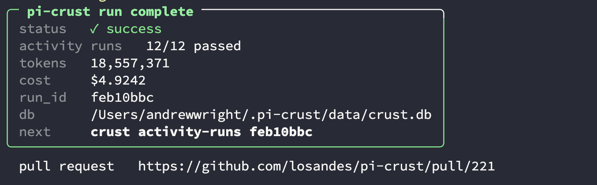
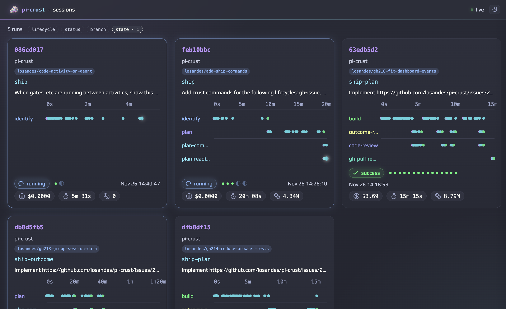
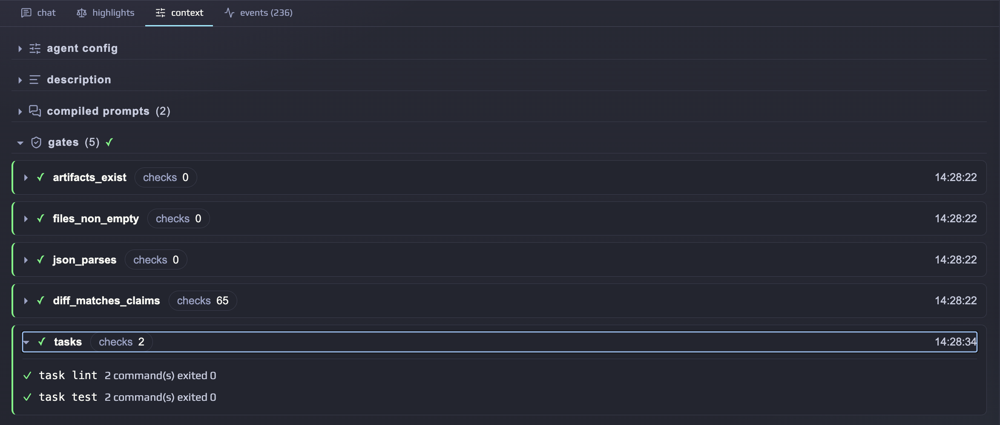
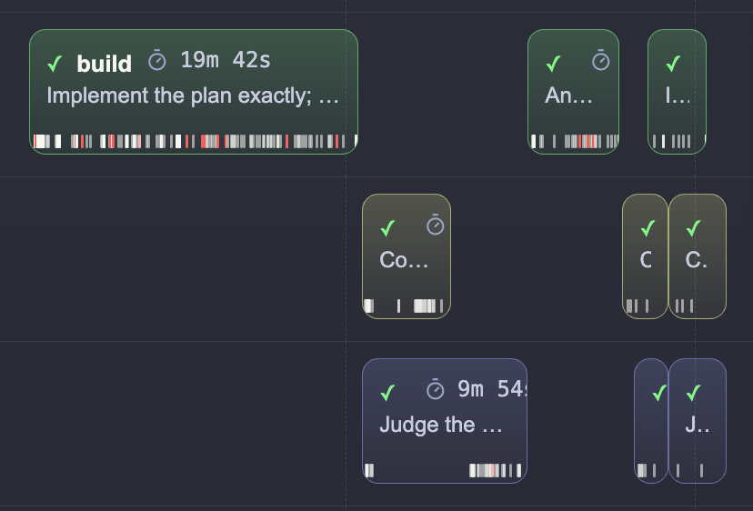
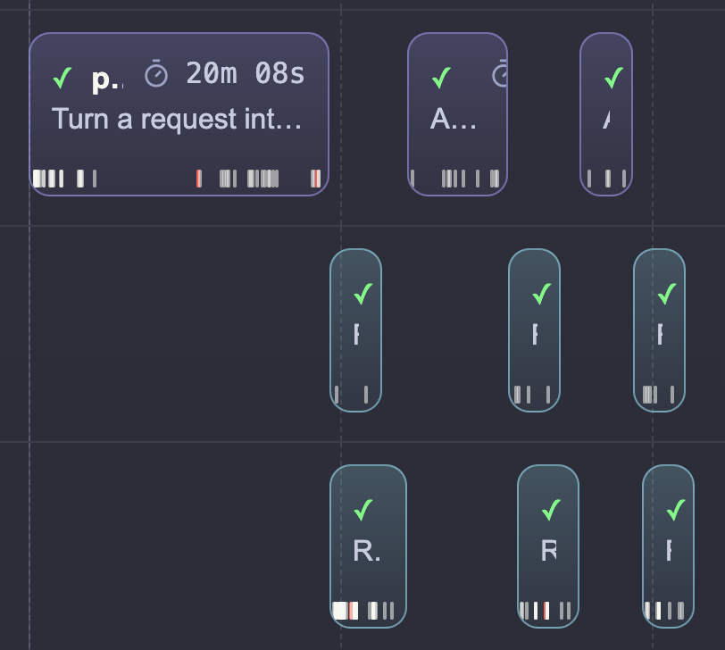
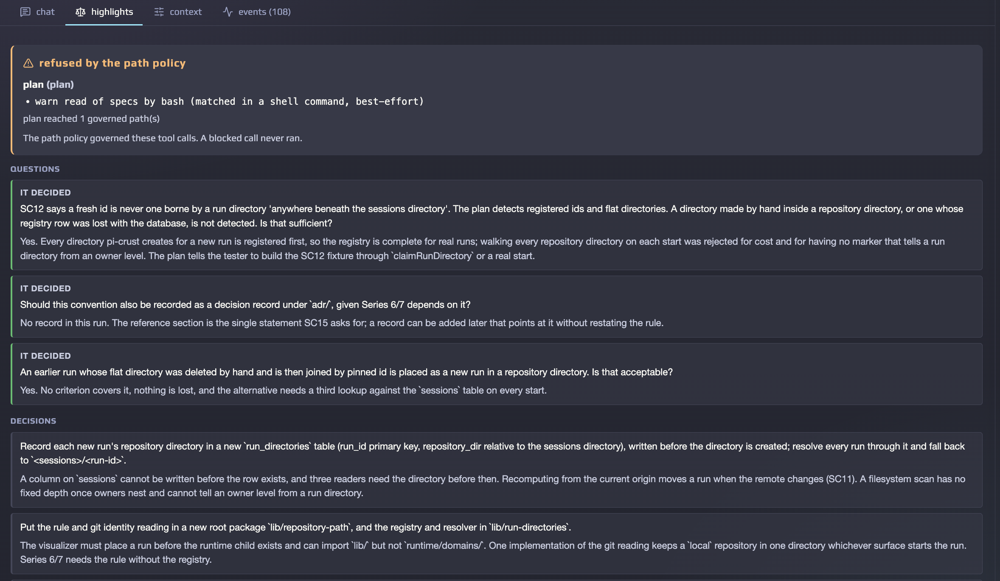
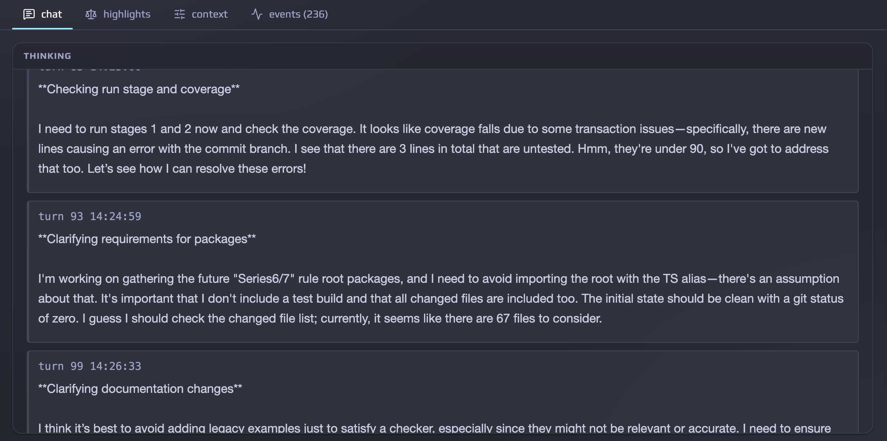
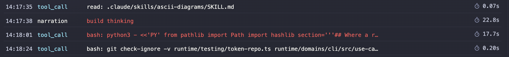
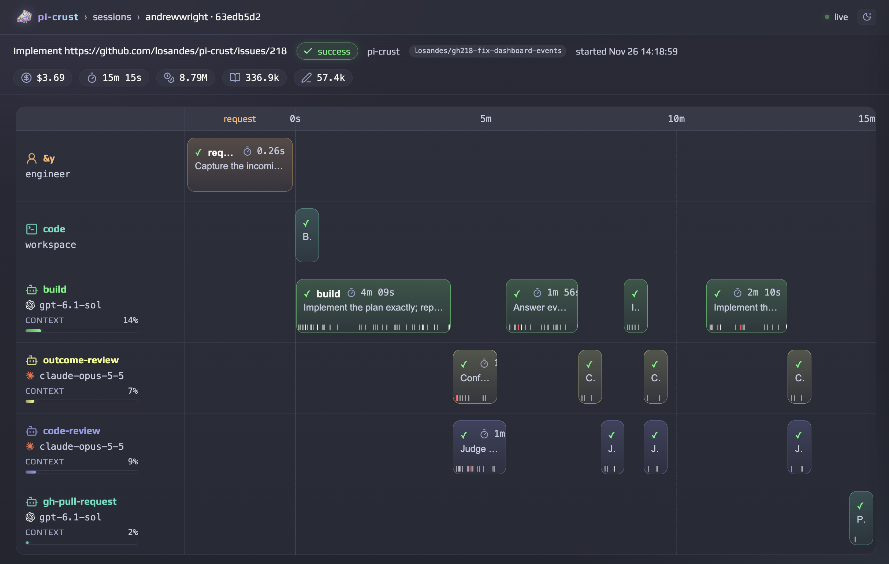

# pi-crust

Run a structured SDLC of observable, autonomous, optionally-unattended, specialist AI agents in your repo. Watch it run, ask it questions, and steer it in mid-flight in the terminal or with the included web app. Connect from anywhere on your network. Revisit past sessions, branch new ones, or dive into how it produced it's outcomes with SQLite traces, archived sessions files, and web design that pulls what's important to the foreground.


*One unattended `ship-outcome` run implementing issue #213 in 1h 24m. The plan went through three rounds with two reviewers before anything was built, the build went through three rounds with two more, and the last Activity opened the pull request. Each lane names the model that Activity ran on.*

## Running one

**TL;DR:** the maintainer's everyday flow, which produces high-quality pull requests: file the work as an issue, edit the issue, then ship it from its own branch. [Getting the most out of it](#getting-the-most-out-of-it) explains why it works.

```sh
crust gh-issue "<the problem, in your words>"
# read and edit the issue it opens
git worktree add ../<repo>-<topic> -b <topic>
cd ../<repo>-<topic>
crust ship-outcome "Implement https://github.com/<owner>/<repo>/issues/<number>"
```

Install with Node 22.19.0 or later (bun is not required):

```sh
npm install -g @polyn/pi-crust
```

Cloning, `bun install` and `bun link` are the [contributor's path](CONTRIBUTING.md#running-your-clone-as-crust). Agents run through pi, which must be on your `PATH` (or named by `PI_PATH`).

Then set up each repository from its root:

```sh
crust init      # writes pi-crust.toml, .env.pi-crust.example, and a .gitignore entry
crust config    # every effective setting, and the file or variable it came from
```

- **Credentials** go in `.env` or `.env.local` at the repository root. `.env.pi-crust.example` lists the keys; you need the key for each provider your models name. The package default model is `anthropic/claude-haiku-5-5`, which needs only `ANTHROPIC_API_KEY`
- **Models** are usually a machine choice, made once for every repository in `~/.pi-crust/config/crust.activities.toml`
- **Repository commands**, such as lint and test, go under `[tasks.<name>]` in `pi-crust.toml`, so they run on the files an Activity changes before its work is accepted. The template declares none until you uncomment one

[Configuration](#configuration) covers the layers, what `pi-crust.toml` may hold, and what `crust init` does and does not touch.

```bash
crust please                          # answer questions, get the command
# tune models once for all repositories in ~/.pi-crust/config/crust.activities.toml
crust help                            # every recipe and flag, plus the above
crust list                            # every Lifecycle and Activity this repo offers
crust ship "<...>"                    # from the problem to an open pull request
crust ship-plan "Implement #<number>" # an issue that already carries a plan
crust run "<...>" --lifecycle bugfix  # a reported bug, from symptom to fix
crust run "<...>" --activities plan,test,build
crust run "<...>" --activities plan,build,outcome-review+code-review   # + runs at once
crust operator "<...>"                # it chooses the chain, then runs it
crust run "<...>" --activities code-review --scope apps/gateway
crust report <run-id>                 # where it got to, and what finishes it
crust join <run-id> <activity>        # talk to the agent that did that work, in its own session
```

A run states what governs it before any agent starts: the machine configuration in force, where its data goes, its trust level, and a link to watch it in the web app. Each Activity then names its model and session as it runs.


When it finishes, it reports how many Activity Runs passed, what it spent, where the trace is, and the pull request it opened.



Useful flags: `--scope` (a ref, a range, a directory, or a glob — what the judging Activities judge), `--approve-after identify,design` (stop for you after those stages), `--commit false` (land nothing; committing is otherwise declared per Activity), `--resume` with `--run-id`, `--handoff specs/{session_id}` (move where this run's documents go), `--name "payments rewrite"` (a label shown instead of the lifecycle).

## Watching one

`crust observe` starts the web app over the shared trace database, listing every repository's runs. `crust observe --host` serves it on every interface, so a phone or a second machine can watch. See [observability](references/observability.md#watching-a-run-from-another-machine).



## Why

Four problems, none which is "write better code than a developer working with an agent directly".

**An agent follows a process differently every time.** You agree on plan, build, test, review — and then it is followed approximately. An Activity gets skipped because the change looked small; a suite is reported passing from a run three edits ago. Nothing stops it, because the process lives in prose that a model interprets.

**A claim and a fact are indistinguishable in prose.** "All 97 files are correct" reads the same whether anything was checked. Failures like these increase costs when we ship bugs to production.

**Authority asserted in a prompt is not authority.** "You are a reviewer; do not change code" is a sentence a model may ignore, and nobody finds out until it has.

**Working memory is fragile.** Everything an agent knows lives in a context window. Compaction eats it, a new session starts blind, and the thread gets rebuilt from `git log`.

### What it does not solve

**This is for work you walk away from.** It will not out-think an attended session, where you continualy steer the agent toward a desired outcome. It is not cheaper or faster. It keeps working on what you asked it to, and can explore what you ask it to from many different angles with just a few choices you make up front.

If you will always be at the keyboard, just run pi, claude, or whatever.

## How

**The sequence is a data structure, not an instruction.** A workflow is a list of Activity names folded by a function. A model cannot skip a stage, because the model is not doing the sequencing. Deterministic code runs the sequence, and calls specialist agents when it's their turn.

**Every claim is addressable.** Agents return typed envelopes, not prose, and the harness verifies them before accepting. A path claimed as changed must exist. An approval that ships blocking items is refused. The run reports how many changed paths no task matched without failing on that count. An agent that doesn't finish it's work is re-prompted rather than credited.



**Each stage reduces one named class of uncertainty**, and hands the next stage a context envelope that distinguishes what it established from what it decided, assumed, or could not answer. The receiving stage is the gate: it may accept, reject, or send the run backwards when evidence invalidates earlier work.



*`outcome-review` asks whether what was built is what was asked for; `code-review` judges it against the repository's conventions. They run concurrently, and their blocking findings go back to `build`, which must fix each one or dispute it with evidence before they rule again.*

The author and its judges deliberately remember different things, in a derivation of Google's [Elephant-Goldfish Model](https://github.com/google/elephant-goldfish-model) (EGM): an elephant that holds the context drafts, and goldfish reviewers without the earlier conversation judge. The planner is the elephant. It keeps one session across every revision round, so it revises knowing why it decided what it did. `plan-comprehension` and `plan-readiness` are the goldfish: neither has seen the planner's conversation. `plan-comprehension` is told everything it may know is in the plan, which tests whether the plan explains itself, and `plan-readiness` checks it against the repository it will run in.

It is EGM-ish rather than EGM, in three ways:

- **The goldfish remember their own earlier rounds.** EGM spawns fresh reviewers every round. pi-crust gives each reviewer one session per run, so in round two it sees the revised plan knowing what it raised in round one. It never sees the planner's reasoning
- **The harness settles the loop, not a person.** In EGM you resolve findings and approve the design. Here the planner must fix or dispute every blocking finding with evidence, the harness refuses a dispute of anything a check decides, and a finding raised twice with no new evidence stops the run for you. `--approve-after plan` adds a stop for you after `plan`
- **It applies past the plan.** `outcome-review` and `code-review` judge the build the same way, with no memory of the builder's conversation



**Authority is placed where it can be enforced, and reported where it cannot.** A protected or gitignored path is refused before the tool call runs, because a secret that has been read cannot be unread — that is the one boundary pi-crust can enforce soundly, since a tool call belongs to the agent that made it. Everything else is observed afterwards and reported: `writes:` per agent is checked against the filesystem after every call, and what an Activity changed without reporting is named for you. Nothing is ever put back. A developer working in the same branch is indistinguishable from an agent in a diff, and guessing wrong destroys work that was never committed. The reviewer agent is still not allowed to fix what it was asked only to judge, and a commit carries only what the Activity was observed to change — never the rest of your working tree.



*An Activity Run's highlights include the path policy verdicts, questions the agent answered for itself, decisions and assumptions it made, and the documents it produced.*

**State is external.** The trace database and the handoff directory outlive the session, so "where did this stop and why" is answered from data, by you or by an agent, hours later. It is resumable. You can branch from an Activity Run into a new session to steer into an alternate set of deliverables.

## What

### Lifecycles

A Lifecycle is a named sequence of Stages, and each Stage runs its Activities in series or at once. Six ship with the package, in `runtime/config/crust.lifecycles.toml`; `crust list` shows them with any your machine or repository adds. `gh-issue`, `ship`, `ship-plan` and `ship-outcome` each have a command of the same name: `crust ship "<prompt>"` starts the same run as `crust run "<prompt>" --lifecycle ship`, and takes every other `crust run` flag. The rest are reached through `crust run --lifecycle`. Below, `→` separates Stages, `,` separates Activities that run in order, and `+` joins Activities that run at the same time.

| Lifecycle      | Runs                                                                                                                          | For                                                                                   |
| -------------- | ----------------------------------------------------------------------------------------------------------------------------- | ------------------------------------------------------------------------------------- |
| `ship`         | `identify`, `plan` → `plan-comprehension` + `plan-readiness` → `build` → `outcome-review` + `code-review` → `gh-pull-request` | A problem, from defining the outcome to an open pull request                          |
| `ship-outcome` | `import`, `plan` → `plan-comprehension` + `plan-readiness` → `build` → `outcome-review` + `code-review` → `gh-pull-request`   | An outcome already written down, in the issue or document the request references      |
| `ship-plan`    | `import`, `build` → `outcome-review` + `code-review` → `gh-pull-request`                                                      | A plan already written down, in the issue or document the request references          |
| `bugfix`       | `diagnose`, `plan` → `plan-comprehension` + `plan-readiness` → `build` → `outcome-review` + `code-review` → `gh-pull-request` | A reported bug; reproducing it comes first and gates the rest                         |
| `de-risk`      | `identify` → `plan`, `build`                                                                                                  | Testing whether a concept is feasible by experimenting, without reviews or delivery   |
| `gh-issue`     | `identify` → `gh-issue`                                                                                                       | Analysing a topic and filing it as a GitHub issue, changing nothing in the repository |

`import` is an engine step, not an Activity: it brings the issue or markdown document the request references into the run before any agent starts. Each review Stage sends its blocking findings back to the Activity that wrote what it judged, and the writer must fix or dispute each one before the reviewers rule again.

### Activities

An Activity is named for the work and IS its agent. Its keyed TOML table says who performs it (model, tools, writes, prompt directory) and what the work is (`output`, `attempts`, `commit`). Package entries live in `runtime/config/crust.activities.toml`, machine preferences in `~/.pi-crust/config/crust.activities.toml`, and repository-specific settings in one `pi-crust.toml`. Later layers merge field by field, with arrays replaced whole. Add an entry and it is runnable without changing a code registry. The engine derives [output checks](references/config.md#output-checks) from what each Activity reports.

Any Activity can run on its own or in a chain you name with `--activities`, whether or not a Lifecycle uses it.

**Defining and planning the work.**

| Activity             | Purpose                                                                                           |
| -------------------- | ------------------------------------------------------------------------------------------------- |
| `scout`              | Find and report where things live; change nothing                                                 |
| `identify`           | Turn a problem into an outcome with criteria anyone could check                                   |
| `conceptualize`      | Decide what the solution must mean and do; choose no technology                                   |
| `design`             | Give the logical architecture a physical shape here, observability included                       |
| `ux-design`          | Specify an interface precisely enough to implement without inventing UX                           |
| `plan`               | Turn a request into a plan the builder can implement without asking questions                     |
| `plan-comprehension` | Report whether the plan explains itself to a reader who has not seen this project; change nothing |
| `plan-readiness`     | Rule on whether the plan can be executed without deciding anything; change nothing                |

**Building and judging the change.** Repository [tasks](references/config.md#tasks) run on the files these Activities change.

| Activity         | Purpose                                                                                             |
| ---------------- | --------------------------------------------------------------------------------------------------- |
| `diagnose`       | Reproduce the reported behaviour and name its cause, with evidence                                  |
| `test-tdd`       | Write the tests that would prove the request was implemented (before build); implement nothing else |
| `build`          | Implement the plan exactly; report every changed file in the envelope                               |
| `test`           | Write the tests that prove the request was implemented (after build); implement nothing else        |
| `outcome-review` | Confirm that what was built is what was asked for; change nothing                                   |
| `code-review`    | Judge the change against this repository's ratified conventions, through its own review skill       |
| `document`       | Write up the change that was just made, from the diff; document only                                |

**Research, when the problem is that nobody knows yet.** Each discipline establishes what is true in its own subject and decides nothing — "find out" and "decide" are different jobs, and a stage asked to do both will quietly do the second while appearing to do the first.

| Activity             | Purpose                                                     |
| -------------------- | ----------------------------------------------------------- |
| `technical-research` | Establish what is technically true, feasible, and evidenced |
| `domain-research`    | Model the domain and the rules that actually govern it      |
| `ux-research`        | Establish what users need, experience, and struggle with    |
| `security-research`  | Establish how this could fail, be misused, or be attacked   |
| `data-research`      | Establish what the data can show, and what it cannot        |

**Delivering the result.**

| Activity          | Purpose                                                                               |
| ----------------- | ------------------------------------------------------------------------------------- |
| `gh-issue`        | Open one GitHub issue carrying the chain's findings; change nothing in the repository |
| `gh-pull-request` | Push the run's branch and open or update one GitHub pull request describing it        |

`gh-pull-request` is a terminal Activity: it may only come last, and it runs once after the chain and its review loops settle.

Two more are **Planners** rather than Activities: `operator` chooses the smallest chain of Activities that can produce the outcome and runs it in the same trace, and `triage` chooses the same chain and hands it back as a command. A Lifecycle cannot name either — they are what chooses a Lifecycle — and configuration can tune them but never add a third.

### Inspecting an Activity Run

Opening an Activity Run shows what the agent was thinking, turn by turn, and every tool call it made, with the duration of each.





### Getting the most out of it

**Settle the outcome in an issue, then ship it.** The flow in the [TL;DR](#running-one) splits the work at the point where your judgement is cheapest to apply:

1. `crust gh-issue` runs `identify`, then opens one issue whose body is identify's document — the outcome and the criteria anyone could check — between `> _Handoff: Identify_` and `> _End of handoffs_` markers. It changes nothing in the repository
2. You read and edit that issue. Correcting an outcome here costs one edit; correcting it after a build costs a review loop. Keep the markers, because the next run splits the body at them
3. `git worktree add ... -b <topic>` gives the run its own branch without disturbing your checkout. Delivery refuses to push from the base branch and does not create a branch for you
4. `crust ship-outcome` with the issue's URL imports the issue and hands identify's document to `plan`, so the run starts from the outcome you approved: plan, plan reviews, build, build reviews, pull request

**Match the chain to the uncertainty.** `ship` is deliberately expensive: it buys success criteria written before anyone plans, a plan two reviewers have ruled on before anyone builds, and reviewers with something other than their own opinion to rule against. Work whose shape you already know does not need that: `ship-outcome` and `ship-plan` start from what an issue already says, and `--activities` runs only the stages you name.



*Issue #218 already carried a plan, so `ship-plan` skipped planning and its reviewers: 15m 15s and $3.69, against 1h 24m and $13.99 for the `ship-outcome` run at the top of this page, which had to plan first.*

**Gate the decisions that are expensive to get wrong.** `--approve-after` is opt-in and the run exits rather than blocking, so a gate costs you nothing until you answer it. Two escalations happen without being asked for: a consequential unresolved question, and a second regression to the same stage.

**Ask the agent that did the work.** `crust join <run-id> <activity>` opens that Activity's own pi session interactively, with its whole conversation loaded — every turn, tool call and revision round it ran. Instead of reverse-engineering a decision from the diff or the trace, ask the planner why it chose that approach, ask the reviewer what it would need to see to approve, or ask the builder to explain a change before you accept it. It joins the latest run of that Activity, and refuses while the run is still going.

**Read the plan before the build runs.** `crust run "<...>" --activities plan` then `crust run "<...>" --run-id <id> --activities build` is cheaper than discovering a bad plan at review.

**Declare your [tasks](references/config.md#tasks).** Put repository commands under `[tasks.<name>]` in `pi-crust.toml`. The installed examples are commented out and declare no tasks until you provide real commands. Matching `change` tasks verify changed files before the Activity's work is accepted and send failures back to the Activity that changed them.

**Expect it to stop.** Waiting is a state, not a failure. So is a regression. A run that stops and tells you why has done its job better than one that guessed. You can override this with `--trust-level 100` (or `--trust-level high`), in which case it will use it's judgement and tell you what decisions it made on your behalf at the end of each Activity.

## Configuration

Every command reads three TOML layers. A later layer overrides an earlier one field by field, and an array replaces the earlier array whole.

| Layer      | Location                                   | Holds                                                                        |
| ---------- | ------------------------------------------ | ---------------------------------------------------------------------------- |
| Package    | `runtime/config/` in the installed package | The shipped Activities, Lifecycles and defaults                              |
| Machine    | `~/.pi-crust/config/`                      | Your choices for every repository on this machine, such as models and themes |
| Repository | `pi-crust.toml` at the repository root     | Tasks, and anything this repository needs to differ                          |

The package and machine directories each hold `crust.config.toml`, `crust.activities.toml` and `crust.lifecycles.toml`; a missing file contributes nothing. A command-line flag beats an environment variable, which beats all three. `crust config` prints the effective value of each setting with the file or variable it came from.

### `crust init`

`crust init` writes exactly three things on a fresh setup: `pi-crust.toml` when it is absent, the credential example `.env.pi-crust.example`, and a `.pi-crust/data/` entry in `.gitignore`. It never overwrites an existing `pi-crust.toml`, writes nothing under the repository's `.pi-crust/`, creates no configuration directory or prompt files, and leaves an existing `justfile` untouched. Package and machine defaults are read on every command, so `crust update` (or `crust init --refresh`) is needed only to refresh what setup wrote, never to pick up a new release's defaults.

Run data does not live in the repository. The trace database and session directories go to `~/.pi-crust/data/`, shared by every repository on the machine, unless `defaults.data_dir` says otherwise.

### `pi-crust.toml`

The template is comments only, so it parses to an empty document. A repository adds its tasks and the settings that differ from the other layers:

```toml
[tasks.lint]
when = [{ on = "change" }]
match = ["**/*.ts", "**/*.tsx"]
run = "<your lint command> {{changed_paths}}"

[tasks.verify-all]
when = [{ on = "deliver" }]
run = "<your full verification command>"

[activities.build]
attempts = 3

[terminal.gh-pull-request]
delivery = { base = "develop", draft = true }

[lifecycles.quick]
description = "Plan and build."
stages = [
  { name = "work", serial = ["plan", "build"] },
]
```

A task runs on one of four triggers: `on = "change"` after an Activity changes files that match, `on = "deliver"` once before the branch is delivered, and `before` or `after` a named Activity's Stage. A failing `change` task goes back to the Activity whose change it judged. `crust verify` runs the `change` tasks over your working tree without starting an agent. Tasks are accepted only in `pi-crust.toml`.

`pi-crust.toml` and `.env*` files are protected by default: an Activity's attempt to read or write them is refused before the tool call runs, so it cannot rewrite the tasks that judge it or read your credentials. Matching paths inside a `bash` command is best-effort.

### Models

Write every model as `provider/model-id`, as `pi --list-models` lists it. Set one default, then override the Activities where a different model earns its cost:

```toml
# ~/.pi-crust/config/crust.config.toml
[defaults]
model = "anthropic/claude-opus-5-5"
thinking = "high"
```

```toml
# ~/.pi-crust/config/crust.activities.toml
[activities.build]
model = "openai/gpt-6.1-sol"
```

The entry keeps everything else the package declares for it. `--model build=<model>@<thinking>` overrides one run.

The full reference, including every field, write boundaries, path protection, prompts and the trust dial, is [references/config.md](references/config.md).

## License

pi-crust is released under the [MIT License](LICENSE).
